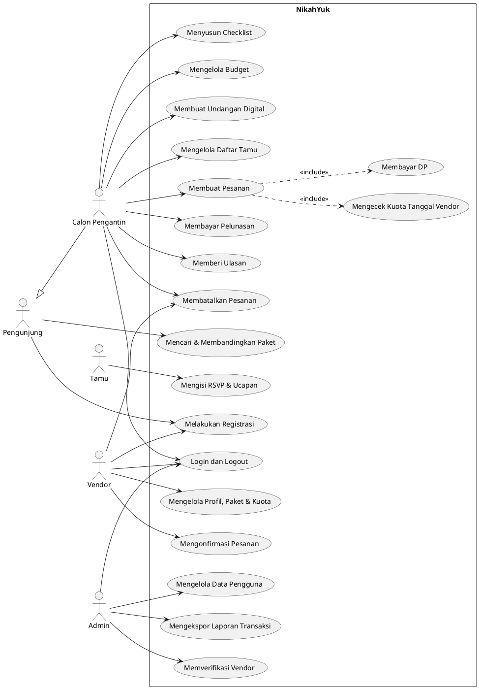

# Software Request — NikahYuk

## Identitas

| | |
| --- | --- |
| **Date** | 13 November 2026 |
| **Description** | NikahYuk adalah aplikasi perencanaan pernikahan yang mempertemukan **Calon Pengantin** dengan **Vendor** terverifikasi (wedding organizer, katering, dekorasi, fotografer, MUA). Calon Pengantin dapat mencari dan membandingkan Paket Vendor, membuat Pesanan, membayar DP dan pelunasan secara online lewat NikahYuk, menyusun Checklist dan Budget Pernikahan, memberi Ulasan, serta membuat Undangan digital lengkap dengan RSVP Tamu, kapan saja dan di mana saja. |
| **Project Sponsor** | Aceng, CEO, Azi Bandar |
| **Co-Sponsor** | Danny Ikan, Azi Bandar |

## Business Need

| Business Need | 1. Tidak Setuju | 2. Ragu-Ragu | 3. Setuju | 4. Sangat Setuju |
| --- | :---: | :---: | :---: | :---: |
| Aplikasi yang dikembangkan mampu meningkatkan pendapatan perusahaan? | ☐ | ☐ | ☐ | ☑ |
| Aplikasi yang dikembangkan mampu mengurangi biaya operasional perusahaan? | ☐ | ☐ | ☑ | ☐ |
| Aplikasi yang dikembangkan mampu meningkatkan produktifitas kerja pegawai? | ☐ | ☐ | ☑ | ☐ |
| Aplikasi yang dikembangkan mampu meningkatkan nilai tambah perusahaan yang bersifat intangible? | ☐ | ☐ | ☐ | ☑ |

## Business Value

**Intangible Value:**

1. Meningkatkan brand recognition perusahaan sebagai platform pernikahan digital di Indonesia.
2. Meningkatkan kepercayaan Calon Pengantin lewat Vendor terverifikasi, dana yang ditahan sampai acara selesai, dan Ulasan yang transparan.
3. Meningkatkan produktivitas tim layanan karena konsultasi, Pesanan, dan pembayaran berjalan online.

**Tangible Value (per tahun, angka contoh):**

1. Mengurangi biaya operasional perusahaan:
    - Sewa booth pameran pernikahan: Rp150.000.000,-
    - Cetak brosur dan katalog vendor: Rp25.000.000,-
2. Meningkatkan pendapatan:
    - Komisi Pesanan Vendor (5% dari transaksi): Rp500.000.000,-
    - Penjualan Undangan Premium: Rp120.000.000,-

## Business Requirements

Use case diagram NikahYuk: 5 aktor, 19 use case. Calon Pengantin mewarisi semua use case Pengunjung.
Membuat Pesanan selalu menyertakan («include») cek Kuota Tanggal Vendor dan pembayaran DP.

| Aktor | Use case |
|---|---|
| Pengunjung | Registrasi, Mencari & Membandingkan Paket |
| Calon Pengantin | Semua use case Pengunjung, Login/Logout, Membuat Pesanan (termasuk cek Kuota Tanggal dan Membayar DP), Membayar Pelunasan, Membatalkan Pesanan, Memberi Ulasan, Menyusun Checklist, Mengelola Budget, Membuat Undangan Digital, Mengelola Daftar Tamu |
| Tamu | Mengisi RSVP & Ucapan |
| Vendor | Registrasi, Login/Logout, Mengelola Profil, Paket & Kuota, Mengonfirmasi Pesanan, Membatalkan Pesanan |
| Admin | Login/Logout, Memverifikasi Vendor, Mengelola Data Pengguna, Mengekspor Laporan Transaksi |

### Aturan bisnis

1. Satu akun Calon Pengantin memiliki satu **Pernikahan** aktif (tanggal, lokasi, nama kedua mempelai). Pesanan, Undangan, Checklist, dan Budget melekat pada Pernikahan. Tanggal Pernikahan terkunci begitu ada Pesanan aktif; pindah tanggal berarti membatalkan Pesanan (aturan refund berlaku) dan memesan ulang.
2. **Vendor** mendaftar sendiri. Profil dan Paketnya baru tampil setelah diverifikasi Admin.
3. Satu **Pesanan** berisi satu Paket dari satu Vendor untuk tanggal Pernikahan. Pesanan dibuat paling cepat 12 bulan dan paling lambat H-30 sebelum Pernikahan.
4. Vendor menetapkan **Kuota Tanggal** (jumlah Pernikahan yang sanggup ditangani per tanggal) dan dapat memblokir tanggal tertentu. Pesanan hanya bisa dibuat jika kuota tanggal tersebut masih tersisa.
5. **DP** sebesar 30% dari harga Paket harus dibayar dalam 1 jam. Jika tidak, Pesanan menjadi **Kedaluwarsa** dan kuotanya dibuka kembali. Harga dikunci saat Pesanan dibuat.
6. Setelah DP dibayar, Vendor harus mengonfirmasi dalam 2×24 jam. Jika Vendor menolak atau tidak merespons, Pesanan menjadi **Ditolak** dan DP di-refund 100%.
7. **Pelunasan** paling lambat H-14 sebelum Pernikahan. Jika tidak dilunasi, Pesanan **Dibatalkan** dan DP hangus.
8. Status Pesanan: Menunggu DP → Menunggu Konfirmasi / Kedaluwarsa; Menunggu Konfirmasi → Terkonfirmasi / Ditolak; Terkonfirmasi → Lunas / Dibatalkan; Lunas → Selesai / Dibatalkan.
9. Pembatalan oleh Calon Pengantin: ≥ H-90 refund 100% dari dana yang dibayar, H-89 s.d. H-30 refund 50%, < H-30 hangus. Pembatalan oleh Vendor selalu refund 100% dan tercatat di profil Vendor.
10. Semua pembayaran masuk ke rekening NikahYuk (escrow). Dana dicairkan ke Vendor pada H+1 setelah Pernikahan, dikurangi **Komisi** 5%. DP yang hangus dicairkan ke Vendor setelah dikurangi Komisi.
11. **Ulasan** (rating 1–5 dan teks) hanya dapat diberikan Calon Pengantin satu kali per Pesanan Selesai. Vendor dapat membalas; Admin dapat menyembunyikan Ulasan yang melanggar.
12. **Budget** otomatis mencatat Pesanan Terkonfirmasi sebagai pengeluaran; Calon Pengantin dapat menambah pos manual.
13. **Undangan** gratis memakai template dasar, maksimal 100 Tamu, dan ber-watermark NikahYuk. **Undangan Premium** dibeli sekali per Pernikahan: semua template, Tamu tak terbatas, tanpa watermark, galeri foto, dan musik.
14. Setiap **Tamu** di Daftar Tamu mendapat link Undangan personal; RSVP dan ucapan terikat ke Tamu tersebut. Tamu tidak perlu akun.
15. Pengguna dan Paket dinonaktifkan, tidak dihapus. Pengguna nonaktif tidak bisa login; Paket nonaktif tidak bisa dipesan, tetapi Pesanan yang sudah ada tetap berjalan. Menonaktifkan Vendor membatalkan semua Pesanan aktifnya dengan refund 100%.
16. Laporan Transaksi diekspor per rentang tanggal dan memuat pembayaran DP dan pelunasan, Komisi dan Pencairan, refund dan DP hangus, serta penjualan Undangan Premium.

## Nonfunctional Requirements

### Operational Requirements

1. Sistem dapat diakses lewat browser desktop dan mobile (Chrome, Safari, Firefox, Edge versi terbaru) serta aplikasi Android dan iOS.
2. Layanan harus memiliki tingkat ketersediaan 99,5% per bulan.
3. Sistem terintegrasi dengan payment gateway untuk DP, pelunasan, Undangan Premium, refund, dan pencairan ke Vendor (transfer bank, e-wallet, kartu kredit).
4. Sistem harus go live sebelum tanggal 1 Juni 2027.

### Performance Requirements

1. Waktu respon halaman dan API tidak lebih dari 2 detik.
2. Mampu diakses lebih dari 500 pengguna secara bersamaan.
3. Halaman Undangan digital tetap terbuka di bawah 3 detik saat diakses 1.000 Tamu bersamaan.
4. Dua Calon Pengantin yang memesan sisa kuota terakhir Vendor pada saat bersamaan tidak boleh sama-sama berhasil.

### Security Requirements

1. Akses ke dalam sistem tanpa otorisasi tidak dimungkinkan; setiap peran (Calon Pengantin, Vendor, Admin) hanya bisa mengakses fiturnya sendiri.
2. Data Paket dan harga hanya dapat diubah oleh Vendor pemiliknya; verifikasi Vendor hanya oleh Admin.
3. Status pembayaran hanya diubah berdasarkan konfirmasi payment gateway, bukan input dari client.
4. Kata sandi disimpan dalam bentuk hash, dan data pribadi pengguna serta Tamu dilindungi sesuai UU Pelindungan Data Pribadi.
5. Seluruh data harus di-backup setiap 24 jam, dan hasil backup disimpan di lokasi yang berbeda dengan sistem.
6. Seluruh komunikasi client-server harus memakai HTTPS (TLS).

### Deadline Requirements

Pengembangan aplikasi tidak boleh melewati jangka waktu yang sudah ditentukan, yaitu go live sebelum 1 Juni 2027.
